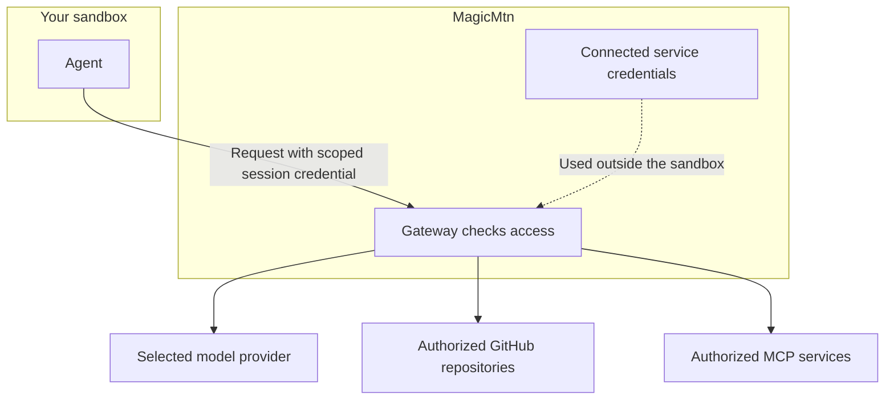

MagicMtn runs your agents in sandboxes and uses a gateway to connect them to models and authorized services. Choose the repositories, tools, and credentials an agent needs for its work.

The sandbox backend supplies the execution boundary. Installed providers and the MagicMtn server run outside that boundary and manage the resources and account connections used by agents.

## Installation count

The shell installer sends an empty request after successful installation to increment an aggregate counter. Reinstallations count again. The event contains no user or installation identifier, OS, version, or command-usage data. The server receives normal HTTP connection metadata, including the source IP address. CLI error reporting is separately opt-in.

Set `MAGIC_NO_ANALYTICS=1` for the installer to skip the count request:

```sh
curl -fsSL https://magicmtn.ai/install.sh | MAGIC_NO_ANALYTICS=1 sh
```

## Cloud credentials and the gateway {#credentials-and-the-gateway}

In MagicMtn Cloud, the gateway forwards model requests using the inference connection you selected. Provider API keys connected through MagicMtn stay outside the sandbox; the agent receives a scoped credential for its session. Connected inference keys are encrypted at rest, and the gateway checks access before forwarding requests.

[GitHub](./integrations/github.md) and [MCP](./mcp.md) connections also keep service credentials outside the sandbox. GitHub access follows your selected repositories and account permissions. Each workspace member authorizes their own MCP access, and MagicMtn checks that authorization when forwarding tool calls.



## Sandbox access

An agent can read files and run commands inside its sandbox, including code and secrets you put there. Give it only the files and service access needed for the task. Keep API keys out of repositories and prompts, and use MagicMtn connections for supported services.

Model requests and tool calls send the information needed to the selected provider or service. Choose connections appropriate for the code and data you plan to work with.

For local Apple Container sandboxes, the provider runs each sandbox in a Linux virtual machine and checks that its image identity, network selection, and absence of host mounts match the saved configuration before executing commands. Files you explicitly copy into the sandbox become accessible to its agent. Other sandbox providers supply their own isolation and network configuration; review the provider's setup guide when choosing a backend.

## Installed providers

Installing a provider authorizes native code to run on the machine hosting MagicMtn, including during installation checks and discovery. Provider processes run with the operating-system permissions of the MagicMtn user and can access that user's files and network. Install packages from maintainers you trust, and use provider accounts with permissions limited to the resources you intend to manage.

The installer checks package hashes, archive paths, and size limits before activation. These checks validate package integrity and structure. Treat the provider executable and its bundled runtime as trusted host software.

## Local server access

`magic server start` runs a single-user server. Its API and dashboard bind to loopback addresses. The CLI authenticates API requests with a bearer credential stored in `~/.config/magicmtn/local/connection.json`; the dashboard uses a separate password printed at startup. The API rejects requests with a browser Origin header.

Protect the local operating-system account and its configuration directory. A process that can read the API credential can manage that local installation. To access the dashboard from another machine, forward its loopback port over SSH as described in the [local server guide](https://github.com/useMagicMtn/magicmtn/blob/main/docs/local-server.md#start-the-server).

## Local provider credentials

Credentials supplied through `magic provider configure` are encrypted with AES-256-GCM in the local SQLite database. The encryption key lives in `provider-credentials.key` in the local data directory, which defaults to `~/.config/magicmtn/local`. The directory is private to your operating-system user, and the key file requires owner-only permissions.

The host supplies the configured credentials to the provider process when it uses that account. Processes with access to both the database and key can decrypt the saved credentials. Protect backups of both, and keep credentials out of provider settings, repositories, and prompts. Use `--secret-file` to supply credentials without putting their values in command arguments or shell history. Protect the original credential file and any credential files created by provider setup.

The local database also stores resource records, buffered terminal output, and inference responses. Treat the database and its backups as sensitive application data.

For managed local Pi sessions, model requests pass through a loopback proxy inside the sandbox and are relayed by the local server to the selected inference provider. Pi receives a sandbox proxy credential. The provider credentials and the local server's API credential stay on the host.

## Local sandbox networking

### Apple Container

Apple Container sandboxes use the `default` network with outbound access. To create local Apple Container sandboxes with networking and DNS disabled, start the server with:

```sh
magic server start --network none
```

The network choice is saved with each sandbox; restarting the server with another choice applies to new sandboxes.

### Firecracker microVMs

Firecracker microVMs use a host TAP interface assigned from the provider's configured network slots. Each concurrent VM needs its own TAP interface, MAC address, and guest IP. Configure host routing, NAT, and firewall rules to control guest access to the internet, the host, and other guests; configure DNS inside the guest.

Keep host-to-guest SSH access available for provider command execution. The provider checks the guest's SSH host key against the configured `known_hosts` file. See the [Firecracker networking setup](https://github.com/useMagicMtn/provider-firecracker/blob/main/USAGE.md#host-and-guest-configuration) for network slots and SSH configuration.

For either backend, model requests relayed by MagicMtn reach the selected inference provider through the host. Choose that provider according to the data your agent will send for inference.
