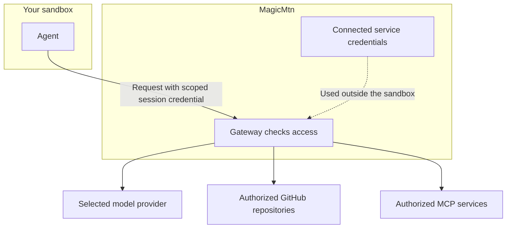

MagicMtn runs your agents in sandboxes and uses a gateway to connect them to models and authorized services. Choose the repositories, tools, and credentials an agent needs for its work.

## Credentials and the gateway

The gateway forwards model requests using the inference connection you selected. Provider API keys connected through MagicMtn stay outside the sandbox; the agent receives a scoped credential for its session. Connected inference keys are encrypted at rest, and the gateway checks access before forwarding requests.

[GitHub](./integrations/github.md) and [MCP](./mcp.md) connections also keep service credentials outside the sandbox. GitHub access follows your selected repositories and account permissions. Each workspace member authorizes their own MCP access, and MagicMtn checks that authorization when forwarding tool calls.

## Sandbox access

An agent can read files and run commands inside its sandbox, including code and secrets you put there. Give it only the files and service access needed for the task. Keep API keys out of repositories and prompts, and use MagicMtn connections for supported services.

Model requests and tool calls send the information needed to the selected provider or service. Choose connections appropriate for the code and data you plan to work with.
